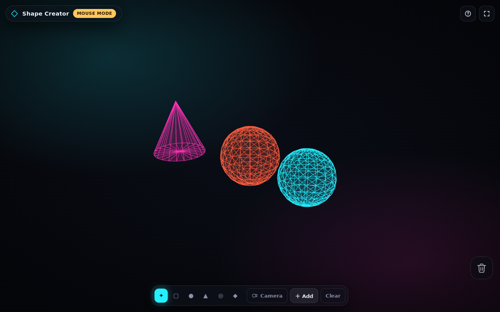
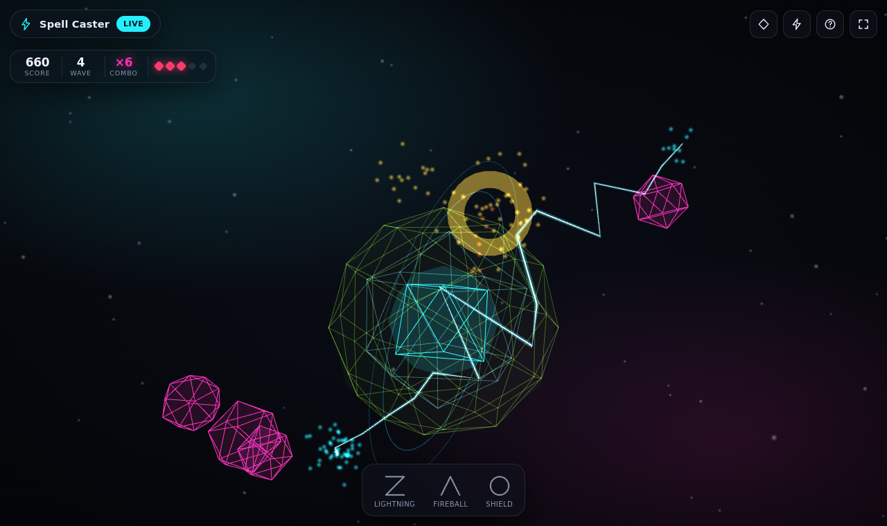

# Shape Creator — hand-gesture 3D playground

Open your hand to **build** a shape in mid-air, twist your palm to **rotate** it, pinch to place it, then drag shapes around with a pinch and drop them in the bin to delete. Just a browser and a webcam — no installs, no server, no video ever leaves the device.

A faster, lighter, rewritten take on the classic [Shape Creator demo](https://collidingscopes.github.io/shape-creator-tutorial/) by [@collidingScopes](https://x.com/measure_plan) — same idea, modern stack and a lot less jank.

And a second mode on the same page and the same hand model: **[⚡ Spell Caster](#-spell-caster)** — draw a Z, a caret or a circle in the air and lightning, fire or a shield answers.

**Live:** https://amogrotex.github.io/shape-creator/ · **Spell Caster:** https://amogrotex.github.io/shape-creator/spell.html



---

## What was wrong before

The original ran the **legacy `@mediapipe/hands`** solution: 1280×720 frames pushed straight into a CPU-bound model, a 3D renderer with no pixel-ratio cap, new geometry + materials allocated for every shape (never disposed), and a blocking load with no feedback. Result: slow first paint, heavy CPU, and half a second of lag between your hand and the shape.

## What changed

| | before | now |
|---|---|---|
| Hand tracking | legacy `@mediapipe/hands`, CPU | **`@mediapipe/tasks-vision` HandLandmarker**, GPU delegate (CPU fallback) |
| Frame sent to the model | 1280×720 | **448 px wide downscale** — ~8× fewer pixels, same accuracy |
| Inference rate | every camera frame, unthrottled | **capped at 30 fps**, auto-throttled to 22 fps on weak devices, skips duplicate video frames |
| Model download | hidden inside the old client, no feedback | **streamed with a real progress bar**, stored in CacheStorage → instant on the second visit |
| Repeat visits | re-download everything | **service worker** caches the shell + three.js + MediaPipe wasm + model (works offline) |
| Startup | blank until everything is ready | camera opens immediately, **3D scene is interactive before the model finishes loading** |
| Pinch detection | raw thumb–index distance, hard threshold | distance **normalised by hand size** (holds at any distance from the camera) + hysteresis, so it never flickers |
| Hand motion | unsmoothed | **One Euro filter** on all 21 landmarks (low latency when fast, calm when still) + **velocity extrapolation** between inferences |
| Gesture rate | tied to the inference rate | gestures run **every render frame** on extrapolated hands, so motion is 60/120 fps smooth even when tracking runs at 30 |
| Rotation | none | **wrist roll** rotates a grabbed shape, **palm twist** rotates the build preview, two hands steer like a wheel; releasing flings a spin |
| Creating shapes | two-hand pinch only | **build mode**: open your palm → live ghost preview, twist to rotate, second open hand to resize, pinch to place |
| Renderer | full DPR, per-shape geometry | **DPR capped at 2 and auto-tuned from frame time**, one shared geometry per shape type, materials disposed on delete, quaternion targets (no euler pop) |
| GPU upload | video → canvas → model | GPU delegate reads the **video element directly** (no per-frame canvas copy); the CPU path still downscales |
| Model prefetch | only after pressing Start | warmed in the background on load (skipped on save-data / 2G), so Start is instant |
| Screen mapping | hard-coded `×10` scale, breaks on mobile/ultrawide | **projection-aware mapping** that accounts for `object-fit: cover` cropping, aspect ratio and mirroring |
| Gestures | two-hand create only | two-hand create + resize, **independent one-hand dragging for both hands**, trash drop, mouse/touch fallback |
| UI | none | onboarding card, live status chip, help sheet, shape picker, keyboard shortcuts, diagnostics (`D`) |
| Errors | silent black screen | explicit camera-permission / download errors with a "try without camera" path |

| Phone profile | same settings as desktop | **auto-detected**: DPR 1.5, no CSS filter on the video, no `backdrop-filter` blur, 60 fps render cap, lighter inference rate and a 320 px CPU input |
| Manual override | — | **⚡ Performance mode** in the top bar (or `P`): DPR 1, smaller model input, 24 fps inference |
| Render loop | one rAF callback = one render | **capped at 60 fps**, so 120 Hz phones do half the work instead of doubling the heat |

Roughly: **~45 % smaller payload on first load** (gzip/brotli CDN + 448 px input), far less CPU per frame, and a first visit that shows something useful in under a second.

## Gestures

- **Build mode** — open your whole hand: a ghost shape appears where your palm is.
  - twist your palm → **rotate** the shape in 3D
  - open your other hand and pull it away → **resize** (the shape sits between the two palms)
  - **pinch** (or close your hand) → **place** it
- **Quick create** — pinch both hands close together then pull them apart; the distance also sets the size, and turning your hands steers the rotation.
- **Move & rotate** — pinch near a shape with one hand, drag it and twist your wrist. Let go to fling a spin. Both hands can hold different shapes at once.
- **Delete** — drop a shape on the bin (bottom right) and let go.
- No webcam? Drag with the mouse or your finger — same rules.

Keyboard: `C` clear · `Space` add · `F` fullscreen · `D` diagnostics · `H` help · `Esc` close. The **⚡ Spell Caster** pill in the top bar switches to the game. The **Camera** button in the toolbar switches from mouse mode to hand tracking at any time.

## ⚡ Spell Caster

A tiny hand-drawn spell game that lives in the same site (`spell.html`), on the same page shell, the same MediaPipe model and the same One Euro smoothing — so switching modes costs nothing extra: the model is already cached by the time you get there.

Your hand is the wand. **Draw a glyph in the air**, the stroke is resampled and matched against three templates by a **$1 Unistroke recognizer** (no trained model, ~4 kB of code), and the spell fires where your fingertip stopped. Magenta wisps close in on the crystal core — kill them before they touch it.



| Glyph | Spell | What it does |
|---|---|---|
| **Z** | **Lightning** | Instant hit, damage 3, **chains** to a second wisp within 2.2 units |
| **^** (caret) | **Fireball** | Flies to the target point, damage 6 with a 1.5-unit blast radius |
| **○** (circle) | **Shield** | 4 s bubble around the core that soaks one hit per wisp and burns 0.8 s per hit |

- **Drawing too small?** Under 60 px of stroke length, or smaller than 14 % of the short side of the screen, the spell **fizzles** ("Draw it bigger") instead of misfiring — phone hands wobble, so this gate matters more than the recogniser itself.
- **Score:** 10 points × combo per kill, combo grows by one per kill (cap ×6) and decays after 3.2 s of peace. Five hearts, a wave every time the field is clear, wisps get faster and tankier as the waves climb.
- **Keyboard:** `H` help · `R` restart · `F` fullscreen · `P` performance mode · `Esc` close/back.
- **No webcam?** "Try with mouse" plays the same game with the pointer — draw with the mouse/finger.
- **On a phone** the same mobile profile applies (DPR 1.5, no `backdrop-filter`, capped render loop), the arena is capped at a 220-particle pool and every effect mesh is pooled or disposed, so the spell page is about as heavy as the shape page — not a second app.

Recognition notes: the templates are rotation-*sensitive* on purpose (`V` and `^` must stay different glyphs), scoring uses the standard `0.5·√2·250` normalisation and a `0.66` acceptance threshold — below that the stroke is rejected rather than guessed. Two cheap tolerances keep real hands from fizzling: the stroke is also scored **backwards** (a Z or a circle traced the other way is the same spell) and **re-normalised from 32 different start points** (a closed loop can begin anywhere — without that a circle started at the side scored 51 %, with it 88-96 %). Measured: Z 91-93 %, caret 92-100 %, circle 84-96 %; flat lines 29 %, `V` 56 %, checkmarks 57 % → all rejected.

The arena also adapts to portrait phones: the camera pulls back so the play field keeps a minimum width instead of blowing every mesh up across a 390 px screen.

## Smoothness & performance notes

- **One Euro filter** per landmark per axis (42 filters/hand). The cutoff adapts to speed: near-zero lag on fast movement, heavy smoothing when the hand is still — the classic answer to "jittery but laggy".
- **Velocity extrapolation**: the last two inferences give a velocity, and the hand position is projected up to 50 ms ahead (damped to 55 %), so shapes follow at the display refresh rate instead of stepping at 30 fps.
- **Adaptive inference**: 60 → 30 → 22 fps, chosen from a rolling frame-time average; `requestVideoFrameCallback`-style duplicate-frame skipping means the model never runs twice on the same camera frame.
- **Adaptive resolution**: pixel ratio drifts between 1 and device DPR based on measured frame time, so slow GPUs keep their frame rate.
- **No per-frame allocations** in the hot path: flat `Float32Array` landmarks, reused buffers, shared geometries, quaternion slerp instead of euler lerp.
- **Momented rotation**: releasing a twisted shape keeps the angular velocity (decays exponentially) — it feels physical for free.

## Run locally

Any static server works — camera access needs `https://` or `localhost`:

```bash
python3 -m http.server 8000
# then open http://localhost:8000
```

## Structure

```
index.html              shell, import map, HUD
styles.css              glass UI, layers, responsive layout
js/main.js              camera bootstrap, gesture state machine, input, overlay
js/scene.js             three.js scene, shared geometry pool, shape lifecycle
js/tracker.js           MediaPipe HandLandmarker, cached model download, camera
spell.html              Spell Caster shell (same page chrome, second mode)
spells.css              arena HUD: hearts, combo, spellbook pills, hurt vignette
js/spell/main.js        HUD wiring, stroke capture, recognise → cast, pointer fallback
js/spell/hands.js       hand → glyph stroke reader (pinch down/up, smoothing, size gate)
js/spell/recognizer.js  $1 Unistroke recognizer + the three spell templates
js/spell/game.js        three.js arena: core, wisps, bolts, fireballs, shield, particles
sw.js                   service worker (cache-first CDN, stale-while-revalidate shell)
manifest.webmanifest    installable PWA
```

Everything is a plain ES module — no build step, no dependencies in the repo.

## On a phone

Phones were the hardest case, and most of the lag was **not** the hand tracking at all — it was the browser compositing the page:

- a CSS `filter` on the full-screen `<video>` forces a per-frame GPU pass, and
- `backdrop-filter: blur()` on every HUD panel re-blurs a region that changes every frame.

Both are switched off on coarse-pointer / narrow screens, which alone is often a double-digit fps gain. On top of that the mobile profile lowers the pixel ratio to 1.5, caps rendering at 60 fps (ProMotion screens were rendering at 120), runs inference at 30/24/18 fps depending on headroom, and keeps the CPU fallback input at 320 px.

If your device still struggles, tap **⚡** (or press `P`): pixel ratio 1, 256 px input, 24 fps inference. The choice is remembered.

## Privacy

The webcam stream is used locally by MediaPipe and never uploaded. The only network requests are three.js, the MediaPipe runtime and the hand model, all from public CDNs.

## Credits

- Original concept and demo: [collidingScopes / Shape Creator tutorial](https://github.com/collidingScopes/shape-creator-tutorial) ([@measure_plan](https://x.com/measure_plan), [funwithcomputervision.com](https://www.funwithcomputervision.com/)).
- [MediaPipe Hand Landmarker](https://ai.google.dev/edge/mediapipe/solutions/vision/hand_landmarker) · [three.js](https://threejs.org/).

MIT licensed — see [LICENSE](LICENSE).
